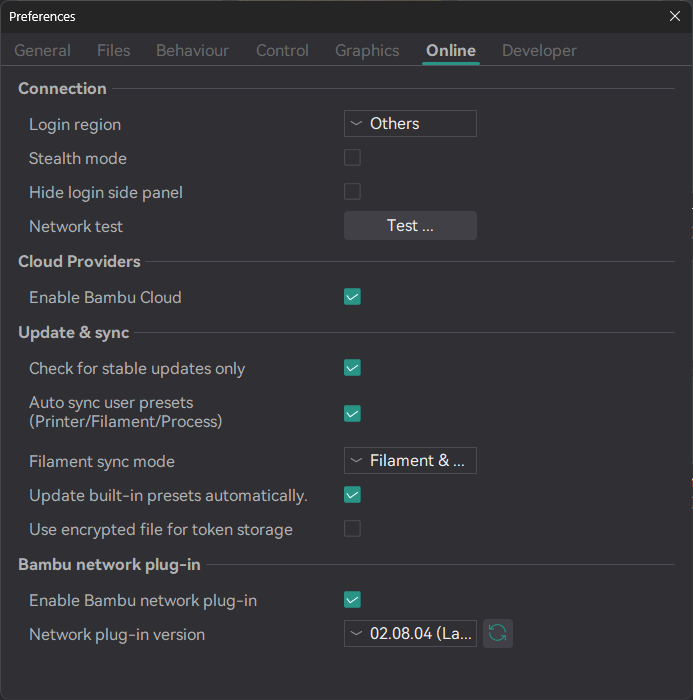

Open Bamboo Networking connects your Bambu Lab printer to OrcaSlicer with full cloud print dispatch, remote camera liveview, and AMS slot sync, without requiring closed source vendor libraries or Developer Mode on the printer.

This plugin is an ease-of-use installer for a modified version of the work from https://github.com/ClusterM/open-bamboo-networking. Most of what makes printers talk is that upstream project. The native library embeds a Bambu Lab application client secret so it can automatically fetch the signing certificates needed for cloud and LAN printing, which means this is not a clean-room implementation. If this plugin saves you time, donations to the upstream author are welcome at https://github.com/sponsors/ClusterM.

## What it does

- **Cloud print without developer mode.** Signs and sends print jobs directly over official Bambu Cloud, with no Developer Mode and no switch to LAN Only mode.
- **Remote camera liveview.** Streams live video when you are away from home through TUTK P2P tunnels, with instant stop and resume reconnects.
- **Instant AMS slot sync.** Restores multi-color AMS slot telemetry and temperatures the moment you connect, keeping sliced filament assignments in sync.
- **In-slicer management tab.** An "Open Bamboo" tab in OrcaSlicer's top bar with real-time status detection and one click installation or rollback.
- **Clean and silent startup.** Fully compliant with OrcaSlicer's security auditor: zero permission popups or socket warnings when OrcaSlicer launches.
- **Cross platform.** Pre-compiled open source native libraries bundled for Windows (x64 and arm64), Linux (x64 and arm64), and macOS (Apple Silicon arm64 and Intel x64).

## Credits and licensing

- The native networking library comes from [ClusterM/open-bamboo-networking](https://github.com/ClusterM/open-bamboo-networking), with patches from [persano/open-bamboo-networking](https://github.com/persano/open-bamboo-networking). It is AGPL-3.0 licensed; the full license text ships inside this plugin package.

## Open source and privacy first

- **Open source native libraries.** Bundles the AGPL-3.0 libraries built from open-bamboo-networking, with the fixes for cloud printing while Developer Mode is OFF, remote TUTK P2P camera liveview, and AMS slot sync. Not a clean-room implementation.
- **Local credentials stay local.** Your printer access codes, local keys, and authentication tokens stay stored on your computer.
- **Safe one click restore.** A complete rollback button restores stock libraries or previous configurations at any time.

## Requirements and compatibility

- **Supported printers:** Bambu Lab P1P / P1S, P2S, A1 / A1 Mini, X1 / X1 Carbon, H2D (all verified from user reports) and X2D (connects and prints, occasional liveview drops under investigation). The H2S runs the same series fixes but I have no report from a real unit. X1E is untested rather than known broken, if you run the plugin on one please open an issue on GitHub with your results.
- **Operating systems:** Windows 10/11 (x64 and arm64), Linux (x64 and arm64), and macOS (Apple Silicon arm64 / Intel x64).
- **OrcaSlicer versions:** OrcaSlicer v2.3.0+ (manual install only) and v2.5.0+ nightly builds (when support for plugins was added).
- **Before reporting "error code 7":** turn **OFF** "Use 3rd Party Print Host" in the printer settings. While it is on, OrcaSlicer sends the job to that host instead of through this plugin (the camera and controls still work) and the send fails. Also, if OrcaSlicer asks for a plug-in version like `v02.08.04.99` or reports the plug-in missing, click **Install / Update Open Bamboo Library** once more and restart.

## How to get started

1. Install this plugin from OrcaCloud.
2. In OrcaSlicer, open the new **Open Bamboo** tab in the top navigation bar.
3. Click **Install / Update Open Bamboo Library**.
4. Restart OrcaSlicer.
5. Open the OrcaSlicer menu (the list icon at the top left), choose **Plugins**, and **tick the checkbox** next to **Open Bamboo Networking Plugin**. If the box stays unticked the library never loads, nothing connects, and this is the step people most often miss.

6. On OrcaSlicer 2.5+, open **Edit -> Preferences -> Online** and tick **Enable Bambu Cloud** under **Cloud Providers**. Until it is ticked, the homepage shows no Bambu Cloud login section. It is a separate checkbox from **Enable Bambu network plug-in** at the bottom of the same page.

7. Log into your **Bambu Cloud** account on the homepage (not just Orca Cloud).

## FAQ & Troubleshooting

- **No Bambu Cloud login section on the homepage:** tick **Enable Bambu Cloud** in **Preferences -> Online -> Cloud Providers** (see the screenshot under "How to get started"). It is not the **Enable Bambu network plug-in** checkbox at the bottom of the same page, and on OrcaSlicer 2.5+ fresh installs the section stays hidden until this box is ticked.
- **Do I need Bambu Studio installed?** No. This plugin is standalone: it bundles its own open source networking libraries, so you do not need Bambu Studio installed and no files need to be copied. It is not a clean-room implementation: the bundled library embeds a Bambu Lab application client secret so it can fetch the required signing certificates automatically.
- **Do I need slicer_key.pem?** No. Cryptographic envelope signing is fully automated in memory, so you never need to extract, generate, or place a slicer_key.pem file. The printer app certificate is provisioned automatically too: since 0.2.24 the bundled library fetches and refreshes it on its own.
- **"MQTT Command verification failed" (HMS 0500-0500-0001-0007):** the printer rejected a signed command. First update this plugin from OrcaCloud, run Install / Update once, restart OrcaSlicer, and send a test print, since 0.2.24 the bundled library fetches and refreshes the signing certificate itself, so a stale certificate is the usual cause. If the error appeared right after a printer firmware update, Bambu's own wiki says to update Bambu Studio to 01.10.02.64 or later, for this plugin just update to the latest plugin version instead, you do not need Bambu Studio. If it persists, attach `open-bambu-networking.log` from the Open Bamboo tab when reporting it.
- **OrcaSlicer Developer Mode toggle:** the Developer mode toggle in OrcaSlicer preferences only unhides experimental slicer settings. It has no effect on printer connectivity or firmware security.
- **Failed to connect to printer / server:** first check `block_cloud = 0` in `obn.conf` in your OrcaSlicer configuration folder (`%APPDATA%\OrcaSlicer\obn.conf` on Windows). The default `obn.conf` template ships `block_cloud = 1`, which blocks all cloud MQTT: if the log shows `blocked by block_cloud`, the plugin has no path to the printer and the slicer reports "Failed to connect". The installer writes or updates this key automatically, if you created `obn.conf` by hand add the line yourself and restart OrcaSlicer. Also make sure you are logged into Bambu Cloud. If your network or ISP restricts TLS on port 8883, you can try adding `lan_tls_skip_verify = 1` to `obn.conf`. For LAN discovery issues, allow inbound UDP port 2021 for OrcaSlicer in your firewall and keep the printer and PC on the same subnet.

## Reporting problems

Hub comments are a poor place for files. Please open an issue on GitHub instead:

https://github.com/persano/open-bambu-networking-plugin/issues

Include:

- **Plugin version:** Open Bamboo tab, or the VERSION line of the changelog on this page.
- **OrcaSlicer version:** Help -> About OrcaSlicer, full string including nightly build hash.
- **Operating system:** Windows Settings -> System -> About, macOS Apple menu -> About This Mac, or `uname -a` on Linux.
- **Printer and firmware:** model plus firmware string from the printer screen (Settings -> General -> Version) or the device panel.
- **Exact error:** full dialog text, `err_code` or HMS code verbatim, screenshot if any.
- **Steps to reproduce:** what you did, and whether the job went through Bambu Cloud, LAN, or the SD card.

Capturing the log:

1. Close OrcaSlicer. Your config folder is `%APPDATA%\OrcaSlicer` on Windows or `~/.config/OrcaSlicer` on Linux and macOS; the Open Bamboo tab shows the exact `obn.log` path.
2. Delete `obn.log` there and add `log_level = debug` to `obn.conf`.
3. Start OrcaSlicer and send a short test print, one small plate is enough, so the failure lands in the log. Then stop.
4. The easy way: click **Export Report for GitHub** in the Open Bamboo tab, it writes a ready to attach zip to your desktop with everything below. Or attach the whole `obn.log` yourself. For rejected signed commands (84033547, 84033543, "MQTT Command verification failed") include `slicer_cert.pem` too, it is a public certificate, safe to share. Never attach `slicer_key.pem`.
5. Files too large for GitHub can go to a file host, paste the link in the issue.

## Disclaimer

This is an independent community project, not affiliated with, endorsed by, or associated with Bambu Lab Inc. The bundled networking library embeds credentials that are not yours, and this plugin automates access to Bambu Lab cloud services. You alone are responsible for ensuring your use complies with the applicable terms and law.

Source code, issue tracking, and pre-compiled packages are available on GitHub:

Plugin: https://github.com/persano/open-bambu-networking-plugin
Native Core: https://github.com/persano/open-bamboo-networking
Upstream project: https://github.com/ClusterM/open-bamboo-networking
